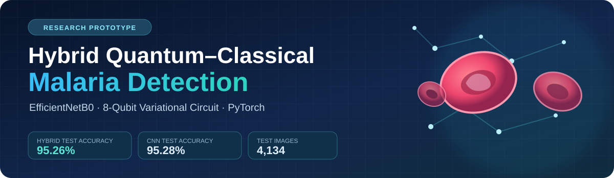
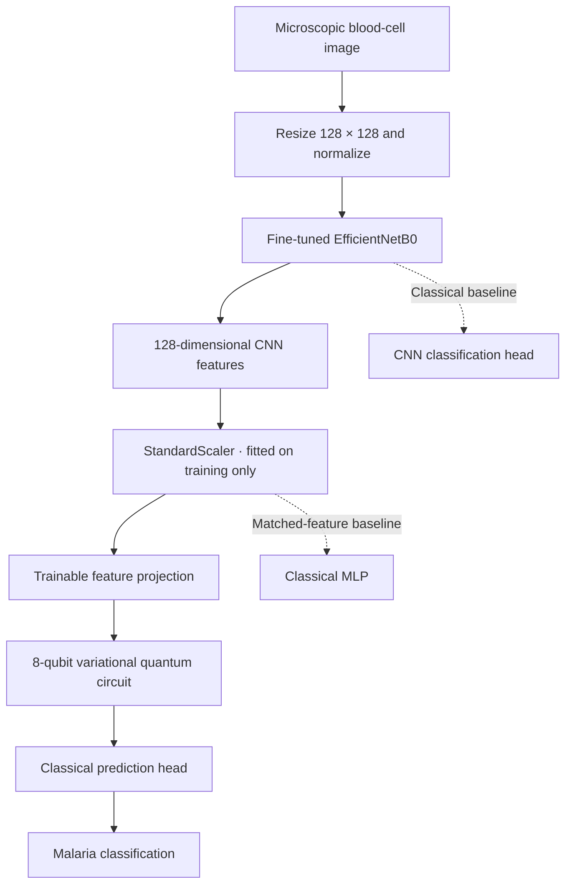
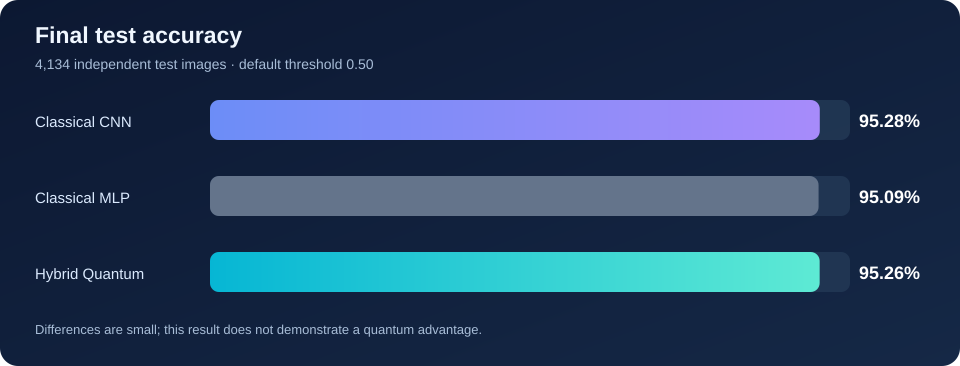

<div align="center">



<br/>

[](https://www.python.org/)
[](https://www.tensorflow.org/)
[](https://pytorch.org/)
[](https://pennylane.ai/)


**A research comparison of classical deep learning and hybrid quantum–classical methods for malaria blood-cell classification.**

[**Explore the notebook**](Quantum_Malaria_Research.ipynb) · [**View results**](#-experimental-results) · [**How to run**](#-getting-started)

</div>

---

## 🔬 Project at a glance

> **Research question:** Can an 8-qubit hybrid quantum–classical classifier match or improve conventional neural networks when classifying malaria blood-cell images?

This project combines a **fine-tuned EfficientNetB0 feature extractor** with a **variational quantum circuit**, and compares it against the full CNN and a parameter-matched classical multilayer perceptron (MLP).

The hybrid model achieved **95.26% accuracy** on the test split—close to the CNN's **95.28%**. **The results do not establish a quantum advantage.**

| 🧬 Dataset | ⚛️ Quantum architecture | 🧠 Input representation | 🧪 Final evaluation |
|:--:|:--:|:--:|:--:|
| 27,558 cell images | 8 qubits · 3 layers | 128 CNN features | 4,134 test images |

## 🧩 Model architecture



**Quantum layer:** 8 qubits, 3 variational layers, and 72 trainable quantum circuit parameters, simulated with PennyLane + PyTorch.

**Dataset labels:** `0` = infected / parasitized; `1` = uninfected.

## 📊 Experimental results

<div align="center">



</div>

**Default decision threshold (0.50)** — evaluated on **4,134** test images:

| Metric | Classical CNN | Classical MLP | Hybrid Quantum |
|:--|--:|--:|--:|
| **Accuracy** | **95.28%** | 95.09% | 95.26% |
| **Precision (infected)** | 97.11% | **97.15%** | 96.64% |
| **Recall (infected)** | 93.43% | 93.00% | **93.86%** |
| **F1-score (infected)** | **95.24%** | 95.03% | 95.23% |
| **ROC-AUC** | 98.92% | **98.93%** | 98.88% |
| **Missed infected cells** | 137 | 146 | **128** |

<details>
<summary><b>View validation-selected thresholds and F2 results</b></summary>

Thresholds were chosen on the validation split, *not* the test split.

| Metric | Classical CNN | Classical MLP | Hybrid Quantum |
|:--|--:|--:|--:|
| Selected infected threshold | 0.155 | 0.200 | 0.305 |
| Accuracy | 92.86% | 94.29% | **94.94%** |
| Recall (infected) | **97.60%** | 96.79% | 95.93% |
| F2-score | 95.81% | **95.85%** | 95.57% |
| Missed infected cells | **50** | 67 | 85 |
| False alarms | 245 | 169 | **124** |

The selected threshold trades off missed infections against false alarms. In this experiment, no single model dominated every metric.

</details>

### Key findings

- The hybrid model **matched the CNN closely in accuracy** but did not outperform it.
- At the default threshold, the hybrid model showed the **highest infected-cell recall** of the three tested systems.
- A validation-set paired comparison between quantum and MLP predictions returned a **McNemar p-value of 0.770867**; the observed accuracy difference was not statistically significant.
- All quantum inference and training used a **classical simulator**, not real quantum hardware.

## 🗂️ Dataset & reproducibility

Data source: [TensorFlow Datasets — Malaria](https://www.tensorflow.org/datasets/catalog/malaria).

| Split | Number of images |
|:--|--:|
| Training | 19,291 |
| Validation | 4,133 |
| Test | 4,134 |
| **Total** | **27,558** |

The images are resized to **128 × 128** and normalized to **[0, 1]**. The CNN feature representations are standardized with statistics fitted on training features only.

## 🚀 Getting started

1. Open [**Quantum_Malaria_Research.ipynb**](Quantum_Malaria_Research.ipynb) in **Google Colab**.
2. Use a Python runtime and execute the notebook **in order**.
3. Allow the notebook to install dependencies, download the dataset and pretrained weights, and train the models.
4. Inspect the stored comparisons and evaluation outputs.

The notebook is the complete uploaded research record. Its **cells and historical outputs are preserved**. Quantum simulator training may take substantial CPU time.

### Repository structure

```text
Quantum-research/
├── assets/
│   ├── research-banner.svg
│   └── test-comparison.svg
├── Quantum_Malaria_Research.ipynb
├── README.md
├── requirements.txt
└── .gitignore
```

> **Checkpoints:** The original run saved trained weights under `/content`. They are **not included in GitHub**; rerun the notebook to regenerate them.

## ⚠️ Research limitations

- **Patient-level separation has not been verified.** The image-level split could contain images from the same patient in different partitions, potentially inflating test performance.
- The reported result has **not been independently reproduced across multiple random seeds**.
- The full notebook has **not been independently re-executed** as part of the repository upload.
- Quantum computation runs in a **simulator**, not on quantum hardware.
- This is a **research prototype, not a clinical diagnostic tool**.

## 📚 References

- [TensorFlow Datasets — Malaria](https://www.tensorflow.org/datasets/catalog/malaria)
- Rajaraman, S., et al. (2018). *Pre-trained convolutional neural networks as feature extractors toward improved malaria parasite detection in thin blood smear images.* [PeerJ 6:e4568](https://doi.org/10.7717/peerj.4568)

---

<div align="center">

**Classical deep learning × Quantum machine learning × Medical image analysis**

[Back to top ↑](#)

</div>
